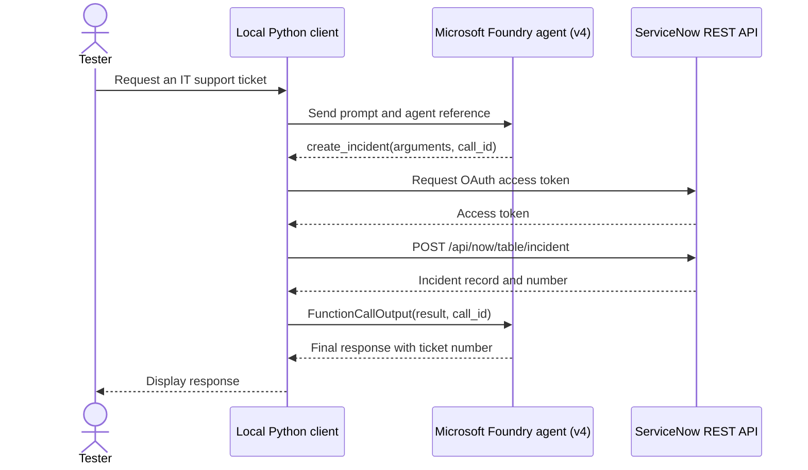

# 🛡️ AgentShield

### Secure-by-Design Enterprise AI Agents

**Building enterprise AI agents with security engineered into the architecture—not added after deployment.**

AgentShield is a hands-on AI security engineering project exploring how organizations can build AI agents that retrieve enterprise knowledge, interact with business systems, and execute workflows within clearly defined security boundaries.

The project uses **Microsoft Foundry, Python, and ServiceNow** to implement an HR/IT assistant for a fictional company, **Northstar Technologies**. It combines practical agent development with the security engineering questions that arise when an AI system moves from *answering questions* to *taking actions*.

> **Core principle:** A model's ability to request an action is not authorization to execute it. Trusted application code must enforce permissions and verify the outcome.

## The business problem

Employees often move between HR portals, IT support systems, and internal documentation to complete routine tasks. An AI assistant could simplify those interactions: an employee might ask about a remote-work policy or request a ticket for a laptop that will not start.

But connecting an agent to enterprise knowledge and APIs creates important questions:

- Can the requester access the information the agent retrieves?
- Who authorizes a requested action: the model, the application, or the downstream system?
- What permissions does the integration identity hold?
- How does the system prevent prompt injection, excessive agency, and unauthorized tool use?
- How can the application distinguish a successful operation from a convincing but incorrect AI response?

**AgentShield explores these questions through implementation, testing, and documented engineering decisions.**

## Current implementation

The working prototype connects an existing **Microsoft Foundry HR/IT agent** to **ServiceNow** through a **local Python client**.

| Capability | Current status |
| --- | --- |
| Foundry HR/IT agent with synthetic policy knowledge and file search | Configured; policy-answer testing previously reported |
| `create_incident` function tool on `AgentShield-HR-IT` version 4 | Implemented; tool request observed |
| Python client handling function calls and returning tool results | Implemented and tested |
| ServiceNow OAuth 2.0 client-credentials token acquisition | Implemented and tested |
| ServiceNow incident creation via REST API | Implemented and tested |
| End-to-end Foundry → Python → ServiceNow incident creation | **Verified** |
| Employee authentication and per-user authorization | Not implemented |
| Hosted FastAPI execution, approvals, monitoring, and deployment controls | Planned |

**Verified demonstration:** A test request about a laptop that would not turn on resulted in a ServiceNow incident. The agent returned ticket number **`INC0010019`**, and the incident was confirmed in ServiceNow.

This result proves the core integration works in the tested local environment. It does **not** establish that the application is production-ready or that employee-level authorization is enforced.

## Implemented architecture



### How the execution boundary works

The Foundry agent identifies a tool it wants to call and supplies structured arguments. **It does not execute the local Python function itself.** The Python client reads the function call, invokes `create_incident()` in `servicenow.py`, and sends the result back to the agent using the matching `call_id`.

The local client uses `DefaultAzureCredential` to authenticate to the Foundry project. The ServiceNow integration separately uses OAuth client credentials. **Neither mechanism, by itself, verifies the identity or permissions of the employee who typed the request.** That boundary is a priority for the next security iteration.

See [Architecture](docs/architecture.md) for component responsibilities, data flows, and the proposed secure deployment design.

## Security engineering approach

The goal is to place security decisions in components that can enforce them, rather than relying on model instructions alone.

| Security principle | Engineering implication |
| --- | --- |
| Identity-aware access | Authenticate the requester and establish a trusted identity outside the model |
| Least privilege | Restrict the permissions of users, applications, and downstream integration identities |
| Independent authorization | Validate tool requests against backend policy before performing business actions |
| Secure retrieval | Apply document access controls; treat retrieved content as untrusted data |
| Verifiable outcomes | Check downstream responses before reporting that an action succeeded |
| Defense in depth | Combine validation, approvals, secrets management, monitoring, and testing |

These are **design principles**, not a claim that every control is already implemented. The current prototype successfully creates incidents, but it still requires stronger authorization, validation, error handling, duplicate-request protection, and operational safeguards.

A particularly useful finding from testing: a simulated tool response led the agent to claim a ticket had been created. That reinforced the need to verify outcomes in trusted code and avoid treating natural-language confirmations as proof.

See [Security Findings](docs/security-findings.md) for observed risks, planned mitigations, and implementation status.

## Technology stack

| Area | Technology | Role |
| --- | --- | --- |
| AI agent | Microsoft Foundry; `gpt-4.1-mini` | HR/IT assistant and function-call generation |
| Knowledge retrieval | Foundry file search | Synthetic HR/IT policy knowledge |
| Application | Python | Local orchestration and tool execution |
| Azure authentication | `DefaultAzureCredential` | Authenticating the Python client to Foundry |
| Enterprise integration | ServiceNow REST API | Creating IT incidents |
| API authentication | OAuth 2.0 client credentials | Obtaining a ServiceNow access token |
| Planned application API | FastAPI | Protected backend endpoints |
| Planned cloud and security tooling | Microsoft Entra ID, Azure Key Vault, Azure hosting, Terraform, monitoring and CI/CD tools | Future security controls and deployment |

## Development roadmap

The project is being built incrementally. The immediate priority is **securing the working integration before expanding its privileges or deployment scope**.

| Workstream | Status |
| --- | --- |
| Existing Foundry agent and HR/IT knowledge retrieval | Configured |
| Function-calling round trip with a mock function | Tested |
| Live local Python-to-ServiceNow incident integration | **Tested end to end** |
| Runtime input validation and reliable failure handling | Improvements identified |
| FastAPI integration and authenticated backend endpoints | Planned |
| Employee identity, action-level authorization, and least privilege | Planned |
| Approval gates and duplicate-action protection | Planned |
| Prompt-injection testing, audit logging, and monitoring | Planned |
| Secure cloud infrastructure and CI/CD controls | Planned |

The longer-term target is an agent architecture in which the interface, agent, trusted backend, identity provider, and business systems have explicit trust boundaries. The target design is documented separately from the current working implementation.

## Repository and documentation

The primary implementation files are:

- `src/foundry_client.py` — communicates with the Foundry agent, handles tool calls, and returns tool results.
- `src/servicenow.py` — obtains a ServiceNow OAuth token and creates incidents through the Table API.

Documentation:

| Document | Contents |
| --- | --- |
| [Week 1 Build](docs/week-01.md) | What was built, how the integration evolved, and what was learned |
| [Architecture](docs/architecture.md) | Current and target architectures, request flows, and trust boundaries |
| [Engineering Decisions](docs/decisions.md) | Design choices, alternatives, and tradeoffs |
| [Debugging Log](docs/debugging-log.md) | Failures, root causes, fixes, and verification |
| [Security Findings](docs/security-findings.md) | Risks, observed behavior, and proposed controls |
| [Testing](docs/testing.md) | Test scenarios, outcomes, and remaining validation |

## Running the local prototype

**Prerequisites:** Access to a configured Microsoft Foundry project containing `AgentShield-HR-IT` version 4 with the `create_incident` function tool; an authorized Azure identity; and a ServiceNow instance configured for the integration's OAuth client-credentials flow and incident creation.

1. Create and activate a Python virtual environment.
2. Install the recorded dependencies from `requirements.txt`.
3. Copy `.env.example` to `.env` and supply the required configuration values.
4. Authenticate locally to Azure using an identity permitted to access the Foundry project.
5. Run the client from the repository root:

   ```bash
   python src/foundry_client.py
   ```

6. Enter a **synthetic test request** and verify the result in the test ServiceNow instance.

**Important:** The current Python client assumes the Foundry agent and its tools have already been provisioned. The complete from-scratch provisioning procedure and clean-environment replication are not yet validated. Do not use production employee data or credentials for this exercise.

## Project scope and limitations

AgentShield is an independent engineering portfolio project using a fictional enterprise and synthetic knowledge documents. A real incident was created in a test ServiceNow environment, but this does not make the implementation suitable for production workloads.

The current implementation lacks employee-level authorization, end-to-end approval enforcement, comprehensive input validation, duplicate-action prevention, and production-grade monitoring. Those controls are part of the ongoing engineering work and will only be marked as implemented when tested.

## References

- [Microsoft Foundry documentation](https://learn.microsoft.com/en-us/azure/ai-foundry/)
- [Azure Identity for Python](https://learn.microsoft.com/en-us/python/api/overview/azure/identity-readme)
- [ServiceNow Developer documentation](https://developer.servicenow.com/)
- [OWASP GenAI Security Project](https://genai.owasp.org/)
- [NIST AI Risk Management Framework](https://www.nist.gov/itl/ai-risk-management-framework)

---

**Engineering focus:** Build useful AI agent capabilities, define their trust boundaries, and verify security behavior rather than assuming the model will enforce it.