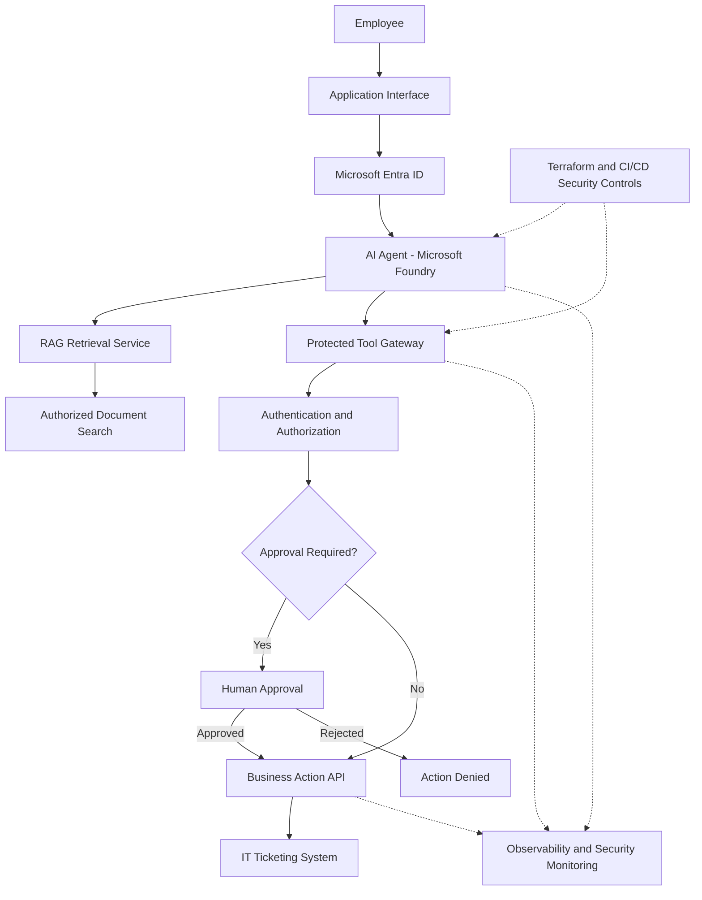

# 🛡️ AgentShield

### Secure-by-Design Enterprise AI Agents

**Building enterprise AI agents with security engineered into the architecture—not added after deployment.**

AgentShield is a hands-on AI engineering and security project focused on designing, building, and securing an enterprise AI agent using Microsoft Foundry, Retrieval-Augmented Generation (RAG), Azure, and DevSecOps practices.

The project explores how organizations can safely adopt AI agents that retrieve enterprise knowledge, interact with business systems, and execute authorized workflows without compromising identity, data security, or operational control.

> **Core principle:** An AI agent should never have more authority than the user or business process it represents.

---

## 🎯 The Business Problem

Organizations are increasingly exploring AI agents to automate repetitive tasks, improve employee productivity, and streamline business operations.

Consider a fictional enterprise, **Northstar Technologies**, with approximately 5,000 employees.

Employees regularly contact HR and IT to:

- Retrieve onboarding documentation and company policies.
- Request access to applications and internal resources.
- Submit IT support requests.
- Navigate employee onboarding procedures.
- Coordinate tasks across departments.

Traditional workflows often involve multiple systems, manual approvals, and repetitive administrative work.

An AI agent could simplify these interactions by allowing employees to make requests through natural language.

However, introducing AI agents creates new security challenges.

**What happens when an AI agent can retrieve sensitive information or perform actions across enterprise systems?**

Organizations must consider:

- How the agent authenticates employees.
- Whether retrieved documents respect existing user permissions.
- How the agent's own permissions are controlled.
- Whether malicious prompts can manipulate tool execution.
- Which actions require human approval.
- How agent activity is monitored and investigated.
- How security controls are enforced throughout the deployment lifecycle.

AgentShield is designed to explore and address these challenges.

---

## 🚀 Project Objectives

AgentShield focuses on three interconnected engineering disciplines.

### 1. AI Agent Engineering

Design an enterprise AI agent capable of:

- Understanding employee requests using large language models.
- Retrieving relevant enterprise documents using RAG.
- Providing grounded responses based on authorized information.
- Interacting with business applications through APIs.
- Executing bounded, multi-step workflows.
- Handling errors and requests requiring human intervention.

### 2. Secure AI Architecture

Implement security controls covering:

- User authentication and identity propagation.
- Role-based and resource-level authorization.
- Least-privilege agent identities.
- Secure retrieval and data access.
- Protected tool and API execution.
- Human-in-the-loop approvals.
- Prompt-injection and tool-misuse defenses.
- Network isolation and secrets management.

### 3. AI Security Operations and DevSecOps

Develop capabilities for:

- Agent activity logging and tracing.
- Detection of suspicious or unauthorized behavior.
- AI-specific security evaluations.
- Automated infrastructure security checks.
- CI/CD security gates.
- Incident investigation and response.

---

## 🏗️ Proposed Architecture

The architecture separates the AI agent's reasoning capabilities from the security controls responsible for enforcing authorization and executing business actions.



### Architecture Principles

**Identity-aware access**

Every request must be associated with a trusted identity. The system should enforce authorization based on the user's permissions and the action being requested.

**Secure retrieval**

RAG must not become a mechanism for bypassing enterprise document permissions. Authorization must be enforced by trusted application and retrieval components.

**Least-privilege tool execution**

AI agents should only access approved tools and perform actions within explicitly defined permissions.

**Independent security enforcement**

Security decisions must not depend solely on LLM instructions. Authentication, authorization, input validation, and approval requirements must be enforced outside the model.

**Defense in depth**

Security controls must complement one another across identity, networking, data access, tool execution, monitoring, and deployment.

---

## 🧰 Planned Technology Stack

| Category | Technologies |
|---|---|
| AI Platform | Microsoft Foundry |
| AI Engineering | LLMs, RAG, Agent Orchestration |
| Programming | Python, FastAPI |
| Retrieval | Azure AI Search |
| Identity | Microsoft Entra ID, Managed Identities |
| API Security | Azure API Management |
| Tool Integration | REST APIs, Model Context Protocol (MCP) |
| Infrastructure | Microsoft Azure, Terraform |
| Secrets Management | Azure Key Vault |
| Monitoring | Azure Monitor, Log Analytics |
| DevSecOps | GitHub Actions, Checkov |
| Security Frameworks | OWASP GenAI Security Guidance, NIST AI RMF |

Technology choices may evolve as implementation requirements and platform capabilities are validated.

---

## 🧪 Enterprise Use Cases

### Use Case 1: Enterprise Knowledge Retrieval

**Scenario**

An employee asks:

> "What is the company's remote work policy?"

The agent retrieves relevant company documentation and generates a grounded response.

**Security considerations**

- Document-level access controls.
- Secure retrieval.
- Source attribution.
- Prevention of unauthorized information disclosure.

### Use Case 2: Employee Onboarding Assistance

**Scenario**

A new employee asks:

> "I'm joining the Cloud Security team next Monday. What do I need to complete before my first day?"

The agent identifies relevant onboarding requirements and assists with permitted tasks.

**Security considerations**

- Identity verification.
- Scoped access to employee information.
- Workflow authorization.
- Human approval for privileged actions.

### Use Case 3: IT Support Automation

**Scenario**

An employee asks:

> "Create an IT ticket because I cannot access my assigned application."

The agent gathers required information and invokes an approved IT ticket API.

**Security considerations**

- Tool allowlisting.
- Input validation.
- API authentication and authorization.
- Audit logging.
- Protection against unauthorized tool execution.

---

## 🔐 Security Engineering Focus

AgentShield explores security threats specific to enterprise AI agents.

| Threat | Security Objective |
|---|---|
| Prompt Injection | Prevent untrusted instructions from bypassing system controls |
| Sensitive Data Disclosure | Enforce authorized access to enterprise information |
| Excessive Agency | Limit agent capabilities and permissions |
| Tool Misuse | Validate and authorize tool execution |
| Privilege Escalation | Prevent unauthorized access or actions |
| Insecure API Integration | Protect downstream business systems |
| Credential Exposure | Secure identities, credentials, and secrets |
| Insufficient Monitoring | Provide traceability and actionable security telemetry |

The project will use synthetic data and simulated enterprise systems to test these scenarios safely.

---

## 🗺️ Implementation Roadmap

| Phase | Engineering Focus | Target Deliverable |
|---|---|---|
| 01 | AI Agent Development | Functional enterprise AI agent |
| 02 | Identity and Authorization | Access-control test suite |
| 03 | Secure Cloud Infrastructure | Terraform security baseline |
| 04 | Secure Tools and MCP | Protected tool execution gateway |
| 05 | AI Red Teaming | Adversarial security assessment |
| 06 | Detection and Response | Monitoring and detection capabilities |
| 07 | AI DevSecOps | Automated deployment security gates |
| 08 | Integration and Validation | End-to-end demonstration and documentation |

Each phase builds on the previous implementation, with security controls introduced and tested throughout the project.

---

## 🧭 Engineering Methodology

AgentShield follows a problem-driven engineering approach:

1. **Define the business requirement** — Identify the enterprise problem and expected outcome.
2. **Research the technology** — Understand relevant services, capabilities, and limitations.
3. **Design the architecture** — Evaluate implementation options, dependencies, and security boundaries.
4. **Implement the solution** — Develop the application and supporting infrastructure.
5. **Validate functionality** — Test expected behavior, failures, and edge cases.
6. **Assess security** — Identify and test potential attack paths.
7. **Document decisions** — Record architecture, tradeoffs, findings, and improvements.

The objective is not simply to create a working AI agent, but to demonstrate how engineering decisions affect its security, reliability, and operational readiness.

---

## 📂 Repository Organization

As development progresses, the repository will contain:

```text
AgentShield/
│
├── README.md
│
├── agent/
│   └── AI agent implementation
│
├── knowledge/
│   └── Synthetic enterprise documents
│
├── api/
│   └── Simulated business APIs
│
├── infrastructure/
│   └── Terraform and Azure configuration
│
├── tests/
│   └── Functional and security tests
│
├── docs/
│   ├── architecture/
│   ├── threat-models/
│   ├── engineering-decisions/
│   └── implementation-notes/
│
└── .github/
    └── workflows/
```

Components will be added as they are developed and validated.

---

## 🎬 Planned Demonstration Scenarios

The final project aims to demonstrate:

**Authorized Knowledge Retrieval**

An employee retrieves company information within their assigned permissions.

**Unauthorized Data Access**

An employee attempts to retrieve restricted HR information, and the system denies access.

**Protected Business Actions**

An AI agent invokes an approved API while respecting authorization and approval requirements.

**Prompt-Injection Resistance**

Malicious instructions embedded in untrusted content are tested against independent security controls.

**Security Monitoring and Investigation**

Suspicious agent activity generates telemetry that supports detection, investigation, and response.

**Secure Deployment**

Automated security checks identify and block defined infrastructure and application security violations before deployment.

---

## 📚 References

- [Microsoft Foundry Documentation](https://learn.microsoft.com/en-us/azure/ai-foundry/)
- [Azure AI Search — Retrieval-Augmented Generation](https://learn.microsoft.com/en-us/azure/search/retrieval-augmented-generation-overview)
- [Microsoft Entra Documentation](https://learn.microsoft.com/en-us/entra/)
- [Azure API Management Documentation](https://learn.microsoft.com/en-us/azure/api-management/)
- [OWASP GenAI Security Project](https://genai.owasp.org/)
- [NIST AI Risk Management Framework](https://www.nist.gov/itl/ai-risk-management-framework)

---

## ⚠️ Project Scope

AgentShield is an independent educational and engineering portfolio project.

Northstar Technologies is a fictional enterprise used to model realistic business requirements and security scenarios.

The project uses synthetic information and simulated business processes. Its architecture and controls are intended to demonstrate engineering practices and should not be interpreted as independently certified or production-ready.

---

## 💡 Engineering Philosophy

> **Security should enable innovation, not become a barrier to it.**

Enterprise AI adoption requires more than connecting a language model to company data and APIs.

It requires understanding how identity, authorization, infrastructure, application logic, and security operations work together.

**AgentShield explores what it takes to build AI agents that are not only capable of performing useful work, but are also designed to operate within clearly defined security boundaries.**
