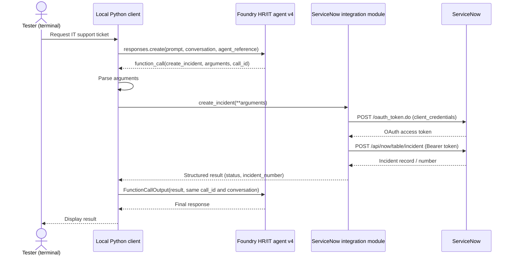
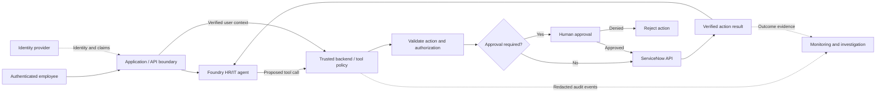

# AgentShield Architecture

AgentShield separates **model-driven tool selection** from **application-controlled execution**. The Microsoft Foundry agent can propose a structured `create_incident` call; the local Python client executes the corresponding function and returns the outcome. The model does not run Python or receive ServiceNow credentials.

This document distinguishes the **working local prototype** from the **proposed security architecture**. See [Week 1](week-01.md) for the build sequence.

## Current implementation

**Verified outcome:** A test prompt created a ServiceNow incident and the agent returned `INC0010019`. The incident was also checked in ServiceNow. This verifies one end-to-end execution path, not all failure or authorization scenarios.

### Component responsibilities

| Component | Responsibility | Execution location |
| --- | --- | --- |
| `AgentShield-HR-IT`, version 4 (`gpt-4.1-mini`) | HR/IT knowledge responses and structured tool requests | Microsoft Foundry |
| Foundry file search | Retrieval from synthetic Northstar HR/IT documents | Foundry-configured knowledge tooling |
| `src/foundry_client.py` | Authenticates to Foundry, starts a conversation, dispatches recognized function calls, returns `FunctionCallOutput` | Local Python process |
| `src/servicenow.py` | Requests an OAuth token, submits an incident, extracts the incident number | Local Python process |
| ServiceNow REST API | Authenticates the integration and creates the incident record | ServiceNow |

The runtime script refers to an **existing** agent version 4. Its local `FunctionTool` declaration documents the schema but does not register that tool during execution. The script handles a single terminal prompt and one round of tool results; it is not a hosted application or a durable chat service.

## Identity and trust boundaries

| Boundary | Data crossing it | Security implication / current state |
| --- | --- | --- |
| Tester → local client | Natural-language request | No employee authentication or per-user authorization |
| Local client → Foundry | Prompt, conversation ID, agent reference | `DefaultAzureCredential` authenticates the local Azure identity; it does not establish the tester's employee permissions |
| Foundry → local client | Function name, model-generated JSON arguments, `call_id` | A tool request is **not** authorization. Comprehensive runtime validation and action policy checks are not implemented |
| Local client → ServiceNow | OAuth client credentials, then Bearer token and incident payload | Application credentials authenticate the integration; least-privilege ServiceNow roles/ACLs have not been independently validated |
| ServiceNow → client → Foundry | API result, structured status, incident number | A downstream write may succeed even if local return handling fails; model wording can also misstate simulated results |

`conversation.id` associates requests in the agent conversation. `call_id` associates a function result with its originating tool request. **Neither identifier authorizes the action.**

### Current limitations

- No employee authentication, delegated authorization, approval gate, or verified ServiceNow least-privilege design.
- Tool arguments are JSON-decoded and passed to Python without comprehensive business validation.
- The ServiceNow function has basic HTTP status checking, but OAuth failures, network errors, ambiguous outcomes, and duplicate submissions are not handled end to end.
- No hosted FastAPI integration, durable audit logging, Key Vault, private networking, or deployment pipeline has been demonstrated.

## Proposed architecture (not implemented)

The target design requires trusted components to authenticate the requester, enforce allowed actions, validate inputs, control integration privileges, confirm downstream results, and record useful audit evidence. **The diagram is an engineering goal, not a deployed architecture.** The exact Foundry tool-to-backend pattern will be selected and validated as implementation progresses.

Related records: [Decisions](decisions.md) · [Security findings](security-findings.md) · [Testing](testing.md).
