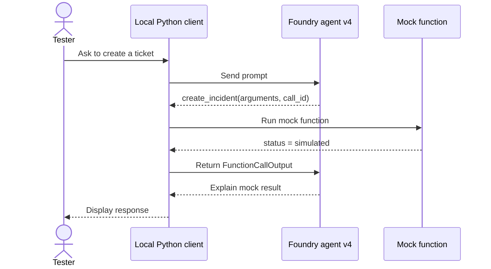
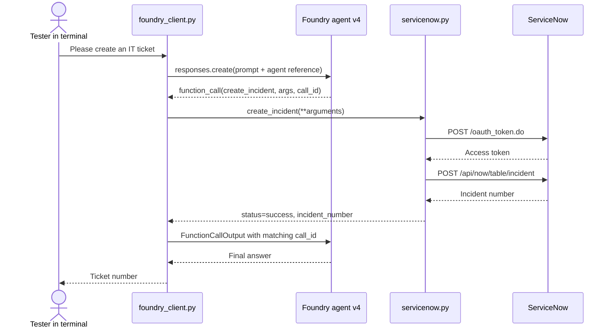

# Week 1 — Building my first working Foundry-to-ServiceNow agent

## What I wanted to build

I wanted an employee to be able to ask an HR/IT assistant a question and, when needed, say something like: *“My laptop won't turn on. Can you create a support ticket?”*

Answering a question and **doing something in another system** are different problems. A model can write a sentence saying a ticket was created, but that doesn't mean a ticket exists. I wanted to understand the full path: how the agent asks for an action, how my application executes it, and how the result gets back to the user.

**By the end of this week, I had a local Python program that connected a Foundry HR/IT agent to ServiceNow and successfully created a test incident.** The test ticket number was `INC0010019`. I also learned why making a tool call work isn't the same as making it secure.

## 1. I started with an HR/IT agent in Microsoft Foundry

My starting point was an existing agent named `AgentShield-HR-IT`. It used the `gpt-4.1-mini` model and synthetic Northstar Technologies policies, including vacation and remote-work guidance, through file search.

The first goal was straightforward: let the agent retrieve information from the supplied HR/IT documents rather than invent company policies. The knowledge-answer behavior had been tested earlier, although I have not consolidated a full repeatable set of those test transcripts in this repository.

**What I learned:** The model produces an answer; the knowledge tool helps it find company-specific information. Neither part, on its own, creates an IT ticket.

## 2. I gave the agent a way to *request* a ticket

I defined a function tool named `create_incident`. It asks for two fields:

```json
{
  "short_description": "Laptop won't turn on",
  "description": "The employee cannot start their laptop and needs IT help."
}
```

In the actual tool definition, both fields are required strings, `additionalProperties` is `false`, and the schema uses `strict=True`.

I extended the existing Foundry agent configuration to **version 4**, which includes this function tool. The current local script also defines a `FunctionTool` object for reference, but **that object is not registered when the script runs**. The code calls an already configured version 4 agent.

This was my first big realization: **a function tool description is not the function itself.** It tells the model what action is available and what inputs to return. My own trusted application still has to perform the work.

## 3. I practiced the full function-calling loop with a mock

Before I connected ServiceNow, I wrote a small mock function. It returned a result similar to:

```json
{
  "status": "simulated",
  "message": "Test only. No ServiceNow incident was created."
}
```

That let me learn the agent interaction without writing to a real system.

The flow was:

1. I typed a request into `foundry_client.py`.
2. My Python client sent it to `AgentShield-HR-IT` version 4 using `responses.create()`.
3. Foundry returned an output item with `type="function_call"`, `name="create_incident"`, JSON arguments, and a `call_id`.
4. Python parsed the JSON using `json.loads()` and called the mock function.
5. Python wrapped the result in `FunctionCallOutput`, keeping the original `call_id`.
6. I made a second `responses.create()` request in the **same conversation**, with the same `agent_reference`.
7. The agent wrote its final answer based on the tool result.



In one mock test, the agent correctly said the ticket **was not** created. That confirmed that the two-request function-calling loop worked. In a later diagnostic mock test, however, the agent said it had created a test ticket even though the tool returned `simulated`. Both observations matter: **a model doesn't always describe tool outcomes reliably.**

### Why were there two API calls?

The first call asks Foundry what to do next. The local Python function then performs—or simulates—the action. The second call gives the result back to the agent. Sending a function definition doesn't cause Microsoft Foundry to run a Python function on my computer by itself.

## 4. I connected Python to ServiceNow

Once the mock loop made sense, I moved to an actual integration. I had already tested ServiceNow's incident endpoint through its REST Explorer and separately confirmed that a Python OAuth client-credentials request could get an access token. Those were useful checks, but neither was yet a complete Foundry-to-ServiceNow flow.

I separated the code into two files:

- **`src/foundry_client.py`** talks to Foundry, receives function calls, chooses which Python function to run, and returns the result to the agent.
- **`src/servicenow.py`** handles ServiceNow authentication and creates the incident using its REST API.

In `servicenow.py`, `get_access_token()` posts the integration credentials to `/oauth_token.do` using the `client_credentials` grant. Then `create_incident(short_description, description)` sends the ticket details to `/api/now/table/incident` with the access token in a Bearer authorization header.

When ServiceNow returns a response with `result.number`, my function returns:

```json
{
  "status": "success",
  "incident_number": "INC0010019"
}
```

That result goes back to the agent as a JSON-serialized `FunctionCallOutput`. The agent then has a ticket number it can share with the user.

**Important distinction:** OAuth client credentials authenticate the **integration application** to ServiceNow. They do **not** prove which employee asked for the ticket or whether that employee is allowed to create it. I haven't implemented employee-level authorization yet.

## 5. The complete working flow



Notice that **Foundry never directly runs `servicenow.py`**. My local client runs it after receiving the tool call. This is client-executed function calling, not a hosted FastAPI service or a Foundry OpenAPI tool.

## 6. Three bugs that taught me how the integration works

I didn't get the full integration working on the first try. These were the most useful problems I solved.

### Problem 1: The client had already closed

I saw `RuntimeError: Cannot send a request, as the client has been closed.` My second `responses.create()` call was outside the `with project_client.get_openai_client()` block. Moving it inside the block kept the OpenAI client alive for both requests.

**Lesson:** A valid API call can still fail if the client object has already been closed.

### Problem 2: The second call couldn't find the model

The next failure was an HTTP 400 complaining that `model` was missing. The first request included `AgentReference(name="AgentShield-HR-IT", version="4")`, but the second one did not. Adding the same agent reference to the follow-up request fixed the issue.

**Lesson:** The tool-result request needs the right conversation and agent context too.

### Problem 3: ServiceNow created a ticket, but Python returned `None`

This was the most surprising bug. ServiceNow showed a new incident, yet my function returned `None`, and the agent told me the creation appeared to have failed.

My success `return` had accidentally been indented inside the `if incident_number is None:` block, *after* the return for the missing-number case. When a real incident number existed, Python skipped the entire block and reached the end of the function—implicitly returning `None`.

The fixed logic is:

```python
if incident_number is None:
    return {
        "status": "unknown",
        "message": "ServiceNow did not return an incident number"
    }

return {
    "status": "success",
    "incident_number": incident_number
}
```

**Lesson:** A failure reported by my program does not necessarily mean the external operation failed. This also creates a duplicate-ticket risk if I automatically retry without checking ServiceNow first.

For full symptoms, causes, and fixes, see [the debugging log](debugging-log.md).

## 7. The successful test

Here is the request I typed:

> My laptop won't turn on. Please create an IT support ticket. This is a test.

And the response in my terminal:

```text
Foundry client initialized
Ask AgentShield: My laptop won't turn on. Please create an IT support ticket. This is a test
Agent response: I have created an IT support ticket for your laptop issue. Your ticket number is INC0010019.
```

I confirmed that the ticket was created in ServiceNow. This is evidence that **one real, end-to-end test worked**: request → Foundry function call → local Python execution → ServiceNow incident → tool result → final agent response.

It does **not** prove that the same setup handles unauthorized users, bad input, outages, repeated requests, or prompt injection. The [testing record](testing.md) separates what I observed from what still needs to be tested.

## 8. What Week 1 taught me about AI security

The most important lesson wasn't simply “I can make an AI agent create a ServiceNow ticket.” It was **where the security decisions need to happen**.

A function call is a model-generated request, not permission. The backend must decide whether the action is allowed. A ServiceNow access token authenticates an integration identity, not the person typing the prompt. And a confident sentence from the agent is not proof that the underlying API operation succeeded.

I also found a real reliability problem: my Python function incorrectly reported `None` after a successful external write. I fixed the return path, but still need to design safe behavior for timeouts and ambiguous outcomes. I found a separate response-integrity problem when the agent claimed that a simulated action succeeded.

These are why I want to build the next controls into trusted application code instead of relying only on the model's instructions.

## 9. What's working, and what isn't

| Working and observed | Not implemented or not tested yet |
| --- | --- |
| Existing Foundry agent and version 4 function tool | Recreating the whole Foundry setup from scratch |
| Local Python client using `DefaultAzureCredential` | Employee sign-in and per-user authorization |
| Mock function-calling loop | Action approvals and strong input validation |
| OAuth token acquisition and real ServiceNow incident POST | Duplicate prevention and reliable failure reconciliation |
| Ticket number returned to Foundry and the tester | Hosted FastAPI / Azure deployment |
| Successful test incident `INC0010019` | Production logging, Key Vault, monitoring, and attack testing |

The current script handles one typed prompt and one round of function results. It doesn't implement a persistent chat interface or a general loop for arbitrary tool requests.

## 10. How to try the current code

The local files are `src/foundry_client.py` and `src/servicenow.py`. They expect an existing `AgentShield-HR-IT` version 4 with `create_incident` already registered, a Foundry project endpoint, Azure access, and a ServiceNow instance configured for OAuth client credentials and incident creation.

```bash
python -m venv .venv
source .venv/bin/activate
python -m pip install -r requirements.txt
cp .env.example .env
# Fill in your own configuration and authenticate locally to Azure.
python src/foundry_client.py
```

The observed package versions are in `requirements.txt`. Python 3.14 is suggested by the local package path, but the exact patch version has not been separately captured. I have **not** verified a clean-environment installation or documented the complete Foundry agent provisioning process, so this isn't yet a copy-and-run tutorial for a new Azure account.

**Be careful:** Running a real ticket request writes to ServiceNow. Don't blindly retry a request whose outcome is unclear. Never commit `.env`, credentials, or access tokens.

## 11. What I'm building next

Next, I want to turn the local proof of concept into a backend that can make security decisions before acting. That means integrating FastAPI, authenticating the requesting user, checking what they're allowed to do, validating tool arguments, controlling approval and retry behavior, and logging outcomes without leaking secrets.

I will record those as *planned* until they're actually implemented and tested.

---

### Related notes

- [Architecture](architecture.md): The components and trust boundaries
- [Decisions](decisions.md): Why I made these choices
- [Debugging](debugging-log.md): The detailed problem-solving record
- [Security findings](security-findings.md): Risks noticed during this build
- [Testing](testing.md): Actual tests and evidence

**Reference starting points:** [Microsoft Foundry Agents](https://learn.microsoft.com/en-us/azure/ai-foundry/agents/), [Azure Identity for Python](https://learn.microsoft.com/en-us/python/api/overview/azure/identity-readme), and the ServiceNow REST API documentation matching the target instance. The exact Microsoft sample revision used during learning has not yet been captured.
